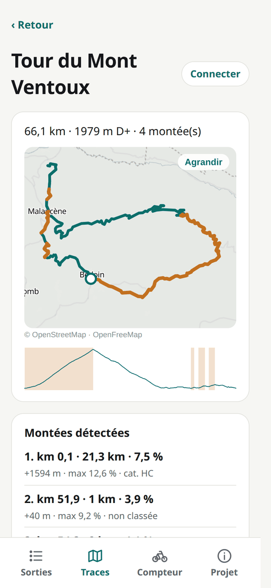
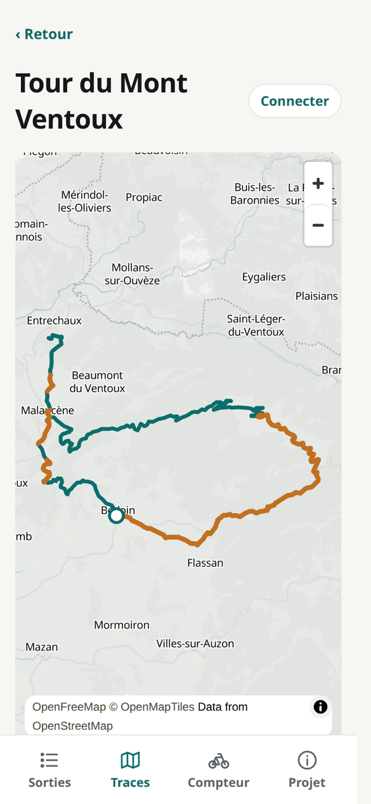
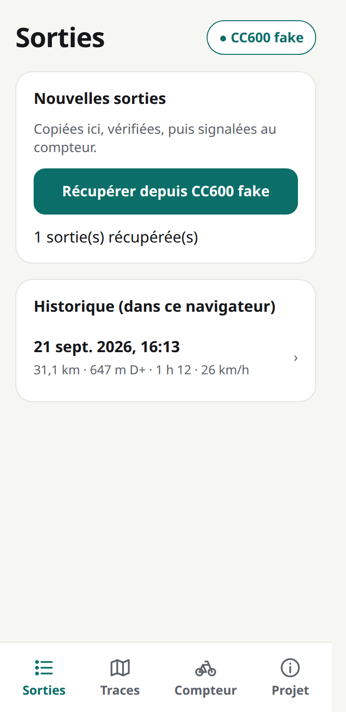
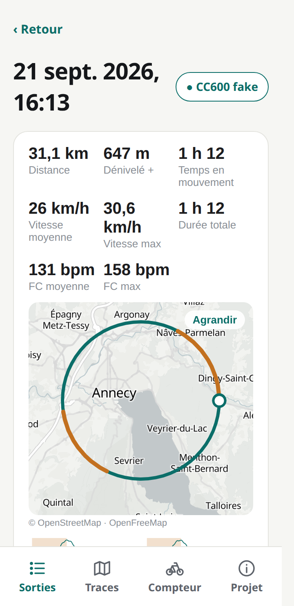
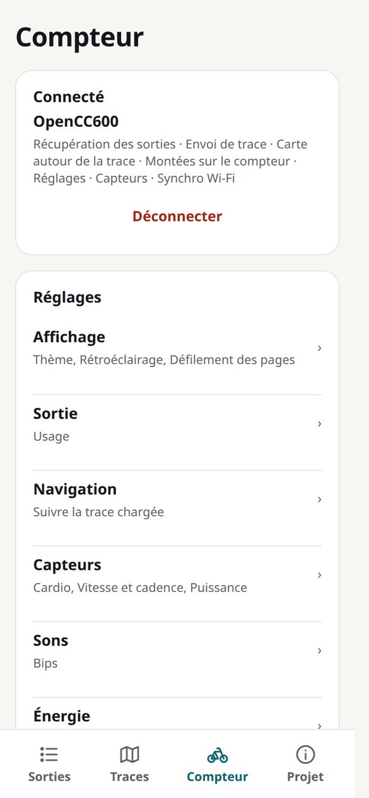
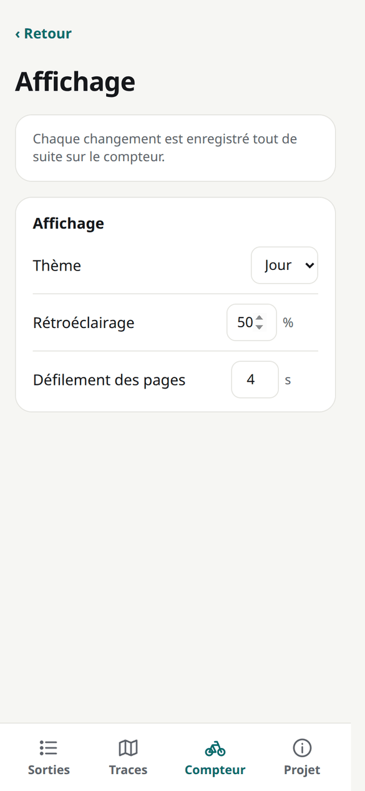

# Musette

**The free companion app for bike computers.** In your browser, on Android and on iOS. No account, no cloud: your rides stay on your device.

> *Musette* — the bag of food handed to riders during a race. This app hands routes to your bike computer and brings your rides back.

Musette is first built to use and share the [OpenCC600](https://github.com/enavarro222/opencc600) firmware (GEOID CC600) while it is being developed, and is designed to support other bike computers too: the Bryton Rider 750 with its stock firmware is the second one.

**Try it:** [enavarro222.github.io/musette](https://enavarro222.github.io/musette/) (Chrome or Edge for Bluetooth). The interface is in French for now.

<p align="center">
  
  
  
  
  
</p>

## Features

### Rides

Connect your bike computer and download the new rides as FIT files. Each ride is copied, its integrity checked (FIT header and CRC), stored on your phone or in your browser, and only then acknowledged to the device: a ride is never lost because a transfer went wrong. Each ride shows its summary (distance, elevation gain, moving time, average speed, heart rate, power when recorded) and opens on its map, elevation profile and climbs. Stored rides can be shared or saved to any other app (intervals.icu, a folder…); the Strava app does not take files, upload them on strava.com.

### Routes

Open a GPX (from Komoot, RideWithGPS, BRouter…): Musette shows it on a map with its elevation profile, detects the climbs and gives each one its length, average and maximum gradient and category (4 to HC). Then send it to the bike computer in one tap. The CC600 receives the climbs with the route, to show them while riding, and a background map around it (OpenStreetMap roads, paths, water, forests and villages, from the OpenFreeMap vector tiles), made as detailed as the device has room for; an interrupted transfer resumes where it stopped.

### Device settings



Change the bike computer's settings from the phone: display, backlight, ride, navigation, sounds, energy, time zone. On the CC600, the ride settings include the FTP and maximum heart rate, and the power and heart rate zones as percentages of them (Coggan's 7 power zones and 5 heart rate zones by default); the device then shows the current zone. Each change is written to the device at once. On the CC600, the paired sensors (heart rate, speed and cadence, power; ANT+ and Bluetooth) are listed too.

### Supported bike computers

| | OpenCC600 | Bryton Rider 750 (stock firmware) |
|---|---|---|
| Connection | Bluetooth | Bluetooth |
| Download rides (FIT), verified before being acknowledged | ✓ | ✓ |
| Send a route | ✓ with its climbs | ✓ Bluetooth (start and arrival turns only) |
| Device settings | ✓ | ✓ Bluetooth |
| Paired sensors | ✓ | |

Adding a device is described in [docs/adding-a-device.md](docs/adding-a-device.md): start with ride download, the app shows only what a driver supports.

### Where it runs

- **Web**: Chrome / Edge (desktop and Android) for Bluetooth. Safari and Firefox do not support Web Bluetooth. Rides and routes are kept in the browser.
- **Android**: native app (Bluetooth), used with a real CC600 and a Rider 750.
- **iOS**: native app from the same code base, not tried yet.
- **Command line** (`musette-cli`): the same sessions from a PC — list, download and sync rides, send routes, read and change settings, capture BLE traffic.

## Planned

- **Map around the route** for the CC600: an OpenStreetMap corridor (roads, paths, water, forests, maybe contour lines) a few hundred KB in size, sent with the route. The file format is ready (`route-cc600`), the app does not build it yet.
- **Wi-Fi transfer** for the CC600: the app gives the device its Wi-Fi credentials over Bluetooth, the device then fetches big files (maps, routes) itself.
- **Faster ride downloads** over Bluetooth (larger reads and packets).
- **Bryton over USB**: the device mounts as a drive (`Activities/*.fit`); the web app has a first version for rides (desktop Chrome / Edge), not tried on a device yet.
- **A first try on iOS.**
- **More bike computers**, and the interface in English.

Ideas and bug reports are welcome in the [issues](https://github.com/enavarro222/musette/issues).

## Repository layout

```
crates/
  protocol-cc600   wire protocol shared with the firmware (no_std, no alloc, no deps)
  route-cc600      CC600 route (OCRT, with its climbs) and corridor map (OCMP) files, shared with the firmware
  settings-cc600   CC600 settings file, shared with the firmware
  fit              FIT integrity checks (header + CRC)
  track            distances, elevation profile, ascent, simplification
  climbs           climb detection and categories
  device           device models and capabilities
  driver-bryton    Bryton stock-firmware driver (USB mass storage, Bluetooth)
  driver-cc600     app side of the CC600 protocol, and a CC600 in memory
  musette-core     what the app asks of the crates, one device session for every model
  musette-wasm     WebAssembly bindings of musette-core (web)
  musette-ffi      UniFFI bindings of musette-core (iOS, Android)
  musette-cli      the command line: talk to devices from a PC (protocol tests, captures, sync)
app/               Expo (React Native) app: web, Android, iOS from one code base
  modules/musette-native   React Native module around musette-ffi (generated)
docs/              architecture and driver notes
```

See [docs/architecture.md](docs/architecture.md).

## Develop

Requirements: Rust (stable) with the `wasm32-unknown-unknown` target, `wasm-bindgen-cli` at the version of `Cargo.lock`, Node 22.

```sh
cargo test --workspace          # core logic
cd app
npm install
npm run wasm                    # build the Rust core for the web (src/lib/core/wasm)
npm test                        # app logic against a simulated CC600
npm run web                     # http://localhost:8081 (Web Bluetooth works on localhost)
```

In development, the device chooser also offers a **simulated CC600** (the device's own Rust code, in the page): rides, routes and settings can be tried without a bike computer. The screenshots above were taken this way.

Android (needs JDK 17, the Android SDK and NDK, `cargo-ndk`, the Rust targets `aarch64-linux-android` and `x86_64-linux-android`):

```sh
cd app
npm --prefix modules/musette-native run generate:android   # Rust core for Android
npm run android                 # builds, installs and starts the app (device or emulator)
```

iOS needs macOS and Xcode (`generate:ios`, then `npm run ios`), or an EAS cloud build.

Every push to `main` is built by CI and deployed to GitHub Pages.

## License

MIT — see [LICENSE](LICENSE). The OpenCC600 firmware is GPL-3.0; it talks to Musette over a protocol and shares only the MIT crates `protocol-cc600`, `route-cc600` and `settings-cc600` (it pins them by git revision), which must never contain code derived from GPL sources.
